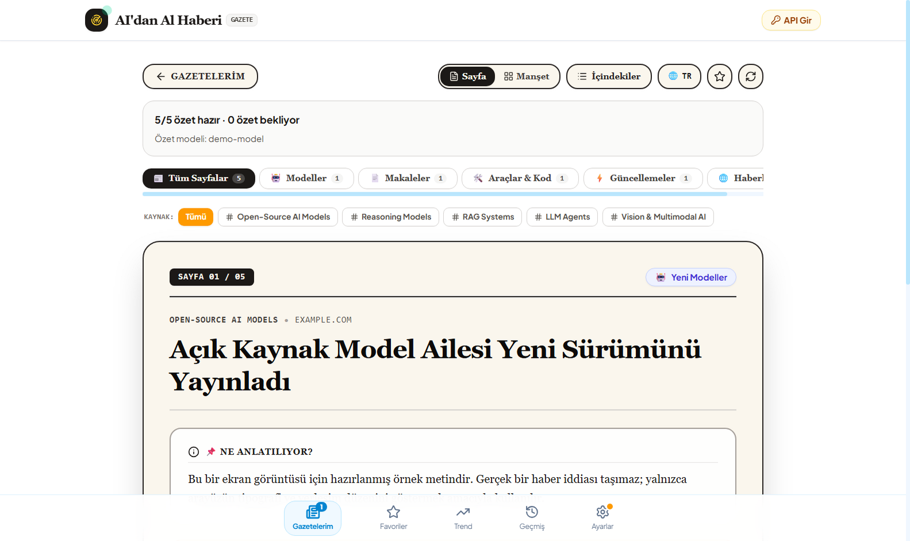
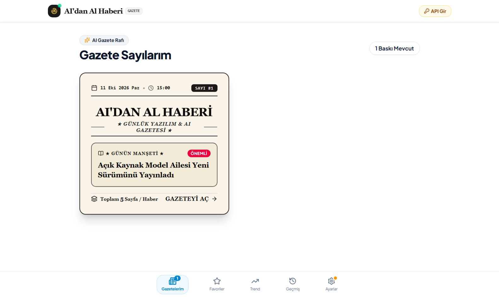
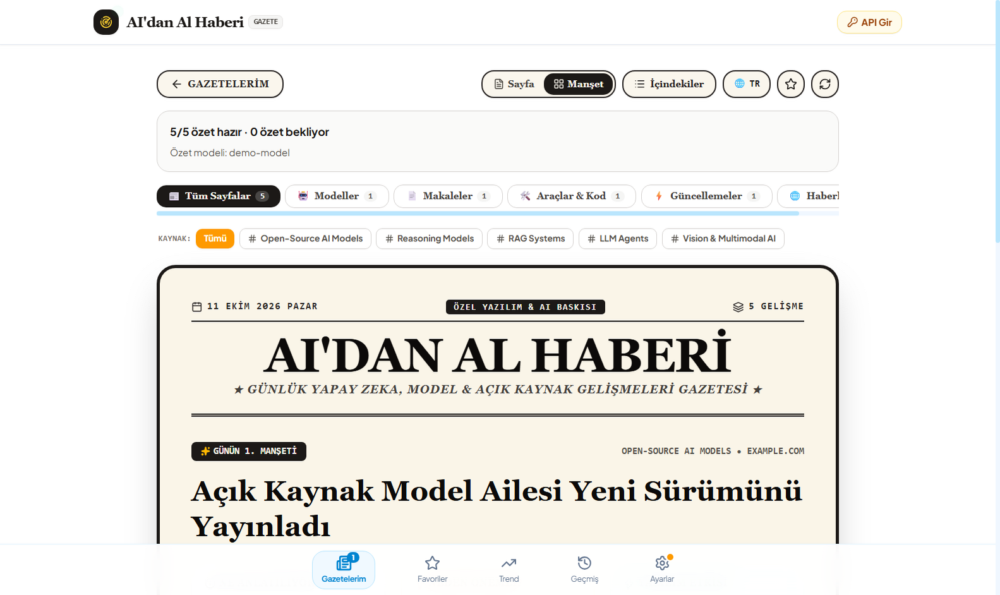
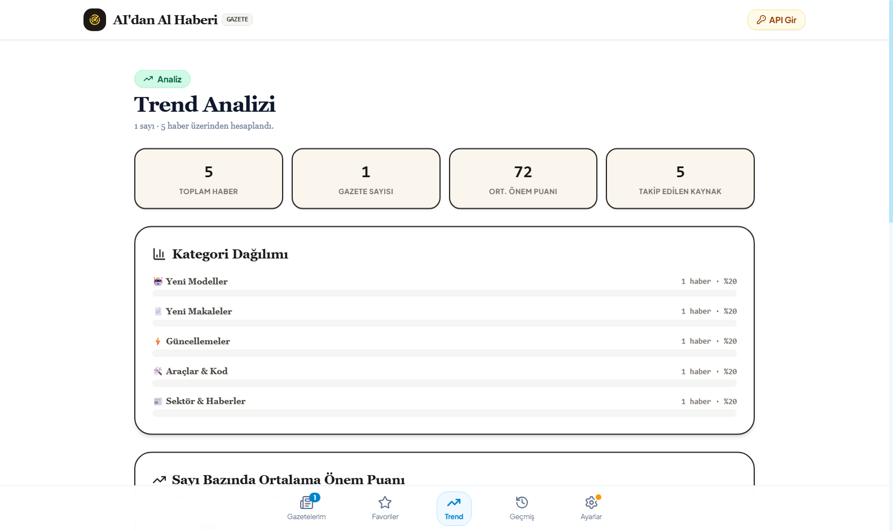

# AI'dan Al Haberi

**A desktop research agent that follows the people and topics you care about, analyses what it finds with Gemini, and publishes the result as a vintage newspaper in Turkish.**

[](LICENSE)
[](package.json)
[](#getting-started)
[](https://www.electronjs.org/)
[](https://react.dev/)
[](https://www.typescriptlang.org/)

> Screenshots below use synthetic sample data, not real articles.



---

## What it does

You give it a list of **people** (`Andrej Karpathy`, `Demis Hassabis`, …) and **topics** (`RAG Systems`, `Open-Source AI Models`, …). Every research run:

1. Searches the web through **Tavily**, restricted to trustworthy AI/software domains.
2. Pulls the **full article text** when a search snippet is too thin to analyse.
3. Removes duplicates against both the current batch and every previously published edition.
4. Asks **Google Gemini** for a structured Turkish analysis of each story.
5. Lays the result out as a newspaper you can actually read — page by page, or as a broadsheet front page.

Each story gets three structured sections: **Ne Anlatılıyor?** (what is it), **Neden Önemli?** (why it matters), and **Yazılım Dünyasına Etkileri** (impact on software). Gemini also assigns a 0–100 importance score, which decides the front-page lead.

## Screenshots

| Newspaper stand | Broadsheet layout |
| --- | --- |
|  |  |



## Features

- **Incremental research** — the first run scans the last 6 months (configurable); later runs only cover the period since the previous edition. A custom date range is also available.
- **Three-layer deduplication** — normalised URL matching, GitHub repository keys, and Jaccard title similarity (0.70 threshold) across current and historical editions.
- **Structured AI output** — Gemini is called with a JSON response schema and the result is validated before it is shown. Malformed or truncated responses are salvaged record by record instead of being discarded wholesale.
- **Per-story checkpointing** — each successfully analysed story is saved immediately. If a later story fails, the completed ones are kept.
- **Explicit pending state** — a story that could not be analysed is stored with its original source text and a visible error, never with invented prose or a fabricated score.
- **Retry pending summaries** — a dedicated action re-runs only the unfinished stories from their stored source text, without repeating any Tavily searches.
- **Favourites** — star any story and revisit it from a dedicated archive.
- **Person/topic filtering** — narrow an edition down to a single tracked source.
- **Trend analysis** — category distribution, average importance per edition, top sources and top stories.
- **TR/EN toggle** — read the Turkish analysis or switch to the original English source text.
- **Free-form search** — one-off searches that bypass the tracked list and are not added to the stand.
- **Local-first storage** — editions, favourites and settings live on your machine. Cloud sync via Supabase is optional.
- **Encrypted API keys at rest** — Tavily and Gemini keys are stored with AES-256-GCM.

## How it works

```
tracked people + topics
        |
        v
   Tavily Search  --->  domain-filtered results
        |
        v
   Tavily Extract --->  full article text (only when snippets are thin)
        |
        v
   deduplication  --->  URL + GitHub repo + Jaccard title similarity
        |
        v
   Gemini (JSON schema, validated)
        |
        +--> valid story ---------> checkpointed immediately
        |
        +--> invalid / truncated --> pending, source text preserved
        |
        v
   newspaper edition (local + optional Supabase sync)
```

## Tech stack

| Layer | Technology |
| --- | --- |
| Desktop shell | Electron 39 + electron-vite |
| UI | React 19, TypeScript 5.9, Tailwind CSS v4, Framer Motion, lucide-react |
| Research | Tavily Search & Extract APIs |
| Analysis | Google Gemini (`generateContent` REST, structured JSON output) |
| Storage | `localStorage` (local-first) + optional Supabase |
| Packaging | electron-builder (NSIS installer + unpacked build) |
| Mobile target | Capacitor (Android project included) |

## Getting started

### Requirements

- Node.js 22 or newer
- A [Tavily](https://tavily.com) API key
- A [Google Gemini](https://aistudio.google.com) API key

### Install and run

```bash
git clone https://github.com/abdurrahmanucak00/aidan-al-haberi.git
cd aidan-al-haberi
npm install
npm run dev
```

### Configure API keys

Open the **Ayarlar** (Settings) tab inside the app and paste your Tavily and Gemini keys. They are encrypted with AES-256-GCM before being written to local storage.

Optional cloud sync is configured **inside the app**: open **Ayarlar** → **Bulut Yedekleme
(Supabase)** and paste the Project URL + anon/public key, then hit **Bağlantıyı Test Et**.
No rebuild is required.

Prerequisites, once per Supabase project:

1. Run `supabase-schema.sql` in the SQL editor (tables + RLS policies).
2. Enable **Authentication → Providers → Anonymous** — the app signs in anonymously
   because it has no login screen.
3. Copy the Project URL and the **anon/public** key from **Settings → API**.

Step-by-step walkthrough: [`docs/SUPABASE-KURULUM.md`](docs/SUPABASE-KURULUM.md) (Turkish).

For dev builds the same values can also be baked in via `.env` (`VITE_SUPABASE_URL`,
`VITE_SUPABASE_ANON_KEY`); values entered in the Settings tab win. Leave them empty to run
fully local. `ENCRYPTION_KEY` is optional too: when unset, a random key is generated on
first launch and stored in `userData/encryption.key`.

### Build

```bash
npm run build          # typecheck + bundle
npm run build:win      # Windows installer + unpacked build
npm run build:mac      # macOS
npm run build:linux    # Linux
```

## Testing

The Gemini transport layer is covered by an offline regression suite. It transpiles the real source, runs it in a sandboxed VM, and mocks every network response — no API keys and no network access are required.

```bash
npm test
```

The suite covers HTTP 503 fallback across discovered models, credential isolation, truncation recovery, duplicate/invalid story indices, exhausted-credential behaviour, and legacy placeholder detection.

Regenerate the README screenshots from the built renderer:

```bash
npm run build && npx electron scripts/capture-screenshots.cjs
```

## Project structure

```
src/
  main/                Electron main process, crypto IPC, window lifecycle
  preload/             Context-isolated bridge (crypto, external links)
  renderer/src/
    components/        Newspaper UI: reader, broadsheet, stand, trends, favourites
    lib/
      gemini.ts        Model discovery, request queue, JSON validation, recovery
      researchEngine.ts Tracked + ad-hoc research pipelines
      tavily.ts        Search and full-text extraction
      jaccardFilter.ts Duplicate detection
      storage.ts       Local persistence, encrypted key handling
      supabase.ts      Optional cloud sync
    types/             Shared data contracts
tests/                 Offline regression suite
docs/screenshots/      README images (sample data)
```

## Reliability & limits

This project takes a deliberately honest position on failure, because AI providers fail in normal operation.

- A **503 `UNAVAILABLE`** response means the model is overloaded. It is not evidence that your credits or daily quota are exhausted, and switching to a backup key does not help — Gemini quotas are applied per project, not per key.
- When a model is unavailable, other discovered models are tried and the failing one is cooled down instead of being hammered.
- When a response is truncated or malformed, complete records are recovered and only the missing ones are retried. Successful analyses are never thrown away.
- **No output token cap is sent.** The model's own default applies; provider quotas still do.
- Stories that cannot be analysed stay marked as **pending** with their source text intact. The app never fabricates a summary to fill the gap.

Known limitations:

- Without `ENCRYPTION_KEY`, the app generates a random key on first launch and keeps it in
  `userData/encryption.key`. Keys encrypted by older builds (fixed dev secret) are still
  readable through a fallback, but re-saving Settings upgrades them to the new key.
- Cloud sync signs in anonymously, so the cloud copy is tied to this device's anonymous
  identity. Reinstalling or wiping app data loses that identity — treat cloud sync as an
  archive, not as cross-device sync.
- Cloud **restore** is not wired into the UI yet: `fetchSessionsFromSupabase` and
  `mergeSessionsLWW` exist but nothing calls them.
- The current Supabase schema does not yet store the structured summary fields, so a
  cloud-restored edition is less rich than the local one.

## Privacy & security

- API keys are never sent anywhere except their own providers, and never written to logs.
- Keys are encrypted with AES-256-GCM before being stored locally.
- The Supabase `anon` key is a public client credential; access is controlled by the row-level security policies in `supabase-schema.sql`, not by keeping the key secret. **Never** commit a `service_role` key.
- `.env` is gitignored. Only `.env.example` with placeholders is committed.
- Screenshots in this repository were generated from synthetic data and contain no personal information.

To report a vulnerability, please see [SECURITY.md](SECURITY.md).

## Roadmap

- Cloud restore: pull cloud editions back into the History view
- Schema migration for structured summary fields
- Arbitrary user-defined tags on favourites
- Additional language targets

## Contributing

Issues and pull requests are welcome. Please read [CONTRIBUTING.md](CONTRIBUTING.md) before opening a PR.

## License

Released under the [MIT License](LICENSE). © 2026 Abdurrahman Uçak.

---

## Türkçe Özet

**AI'dan Al Haberi**, takip ettiğiniz kişileri ve konuları otomatik tarayıp bulduğu gelişmeleri yapay zekâ ile Türkçe analiz eden ve **nostaljik bir gazete formatında** sunan bir masaüstü uygulamasıdır.

**Öne çıkanlar:** artımlı araştırma (ilk çalıştırmada 6 ay, sonrasında yalnızca yeni gelişmeler) · üç katmanlı mükerrer filtresi (URL, GitHub repo, Jaccard başlık benzerliği) · tam metin zenginleştirme · Gemini ile yapılandırılmış Türkçe analiz ve 0-100 önem puanı · favoriler · kişi/konu filtresi · trend analizi · TR/EN geçişi · serbest arama.

**Dayanıklılık:** Her özet tamamlandığı anda kaydedilir; bir haber başarısız olduğunda diğerleri korunur. Analiz edilemeyen haberler **"özet bekliyor"** olarak, özgün kaynak metniyle birlikte saklanır — uydurma özet veya puan üretilmez. "Bekleyen Özetleri Tamamla" düğmesi yalnızca eksik özetleri yeniden dener ve Tavily aramasını tekrarlamaz.

**Önemli not:** Gemini `503 UNAVAILABLE` yanıtı modelin yoğun olduğunu gösterir; kredinizin bittiğini **kanıtlamaz**. Gemini kotaları proje bazlıdır, bu yüzden aynı projedeki yedek anahtar ek kota sağlamaz.

**Kurulum:** `npm install` → `npm run dev` → uygulama içindeki **Ayarlar** sekmesinden Tavily ve Gemini anahtarlarınızı girin. Anahtarlar cihazda AES-256-GCM ile şifrelenir.

**Test:** `npm test` — Gemini katmanını ağ erişimi ve API anahtarı olmadan doğrulayan çevrimdışı test paketi.

Lisans: [MIT](LICENSE) © 2026 Abdurrahman Uçak
